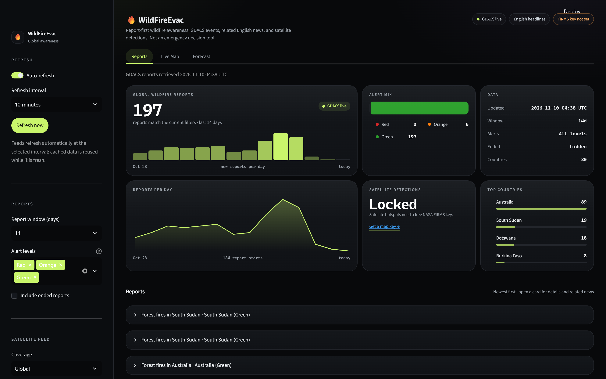
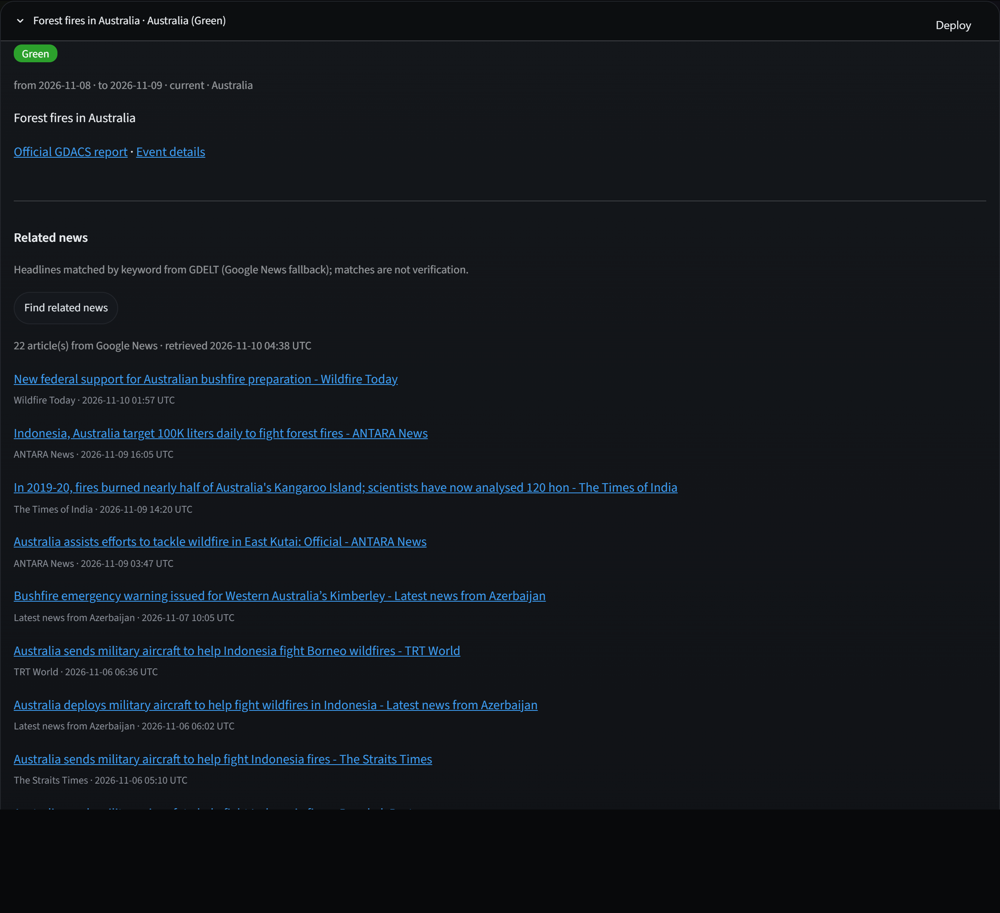

# Wildfire evacuation risk forecasting

> **Development status:** This project is still under active development. Features,
> forecasts, and documentation may change; do not rely on it for emergency
> decisions.

The project will estimate whether a wildfire threatens an evacuation zone using
only information available during the fire's first five hours. The target
forecast horizons are 12, 24, 48, and 72 hours after that observation window.

The initial stack is:

- Python for the data and modeling pipeline
- pandas for tabular data preparation
- scikit-learn for preprocessing, imputation, and validation
- scikit-survival for Kaplan-Meier estimates and time-to-event models

Survival analysis can account for fires whose follow-up ends before a threat
event is observed (right censoring). The event definition, censoring rules, and
whether horizons are measured from ignition or the end of the five-hour window
must be established before training.

## Set up

Use Python 3.10 or newer.

Windows (PowerShell):

```powershell
py -3.10 -m venv .venv
.\.venv\Scripts\Activate.ps1
python -m pip install --upgrade pip
python -m pip install -e .
```

macOS/Linux:

```bash
python3 -m venv .venv
source .venv/bin/activate
python -m pip install --upgrade pip
python -m pip install -e .
```

The default install contains only what the web app needs. The offline
survival-analysis scripts additionally need the model stack:

```powershell
python -m pip install -e ".[models]"
```

If scikit-survival has no compatible wheel for the local Windows/Python
combination, use a supported Linux environment such as WSL and install from
this same project manifest there.

## Run the web app

The app opens on **Live Globe**, an interactive 3D globe with GDACS wildfire
reports and, when configured, NASA FIRMS satellite hotspot detections. Drag to
rotate, scroll to zoom, and click a point for its details. The globe uses a
static NASA Blue Marble texture as its base imagery; only the report and
hotspot overlays are live data. The **Reports** tab shows GDACS events, with
related English headlines from GDELT and Google News. The **Forecast** tab
contains the current offline forecast outputs. GDACS reports are official
reports; satellite detections are not verified fire perimeters, evacuation
boundaries, or forecasts.





Reports and related news need no credentials, and the GDACS globe layer works
without one. Satellite hotspots need a free NASA FIRMS map key (register on
the [FIRMS API map key
page](https://firms.modaps.eosdis.nasa.gov/api/map_key/)). Without a key the
globe still renders the report layer and explains how to add hotspots.

Set `FIRMS_MAP_KEY` for the current PowerShell session without echoing the
value, then launch the app:

```powershell
$secureKey = Read-Host "FIRMS map key" -AsSecureString
$keyPointer = [Runtime.InteropServices.Marshal]::SecureStringToBSTR($secureKey)
try {
    $env:FIRMS_MAP_KEY = [Runtime.InteropServices.Marshal]::PtrToStringBSTR($keyPointer)
}
finally {
    [Runtime.InteropServices.Marshal]::ZeroFreeBSTR($keyPointer)
}
python -m streamlit run app.py
```

On macOS/Linux, set the variable with `export FIRMS_MAP_KEY=...` in your
shell, then run the same `streamlit run` command.

The key is read only by the Python backend, never put in browser code or
committed. Do not paste it into source files, screenshots, issue reports, or
Git. If a key has been shared publicly or in an unintended place, revoke it
and use a newly generated key. The feed can query up to five recent days and
supports NASA FIRMS VIIRS/MODIS NRT sources. Attribution: NASA FIRMS.

The report window uses each event's last GDACS report date, and the sidebar
can hide low-impact Green alerts or include ended reports.

## Run tests

The web app and data-client tests run with the core install:

```powershell
python -m unittest tests.test_firms tests.test_gdacs tests.test_news tests.test_google_news
```

The full suite also covers the offline survival models, so install the
optional stack first:

```powershell
python -m pip install -e ".[models]"
python -m unittest discover -s tests -p "test_*.py"
```

The network clients are tested with mocked responses, so the suite runs
offline.

## Kaplan–Meier baseline

The training CSV must contain `time_to_hit_hours` and `event` (1 = observed
hit, 0 = right-censored). A censored fire contributes to the risk set only
through its recorded follow-up time; it is not treated as a hit afterward.

```powershell
python scripts\plot_kaplan_meier.py C:\path\to\train.csv
```

The script reports hit and censored counts, estimates cumulative hit
probability as `1 - S(t)` where follow-up supports the horizon, and saves the
curve to `artifacts\kaplan_meier_train.png` by default.

## Fixed-horizon labels

Build labels from the training set without changing its source file:

```powershell
python scripts\build_horizon_labels.py C:\path\to\train.csv
```

For each horizon, a hit at or before the horizon is labeled `1`. A fire with
follow-up through the horizon and no hit by then is labeled `0`. A fire
censored before the horizon is left unknown (blank in the output CSV) and
excluded from that horizon's binary evaluation. A censor time exactly at the
horizon is known safe through that horizon and is labeled `0`.

The derived CSV includes `threat_by_12h`, `threat_by_24h`, `threat_by_48h`,
and `threat_by_72h`; the script prints positive, negative, and unknown counts
for each. By default it writes to `artifacts\train_horizon_labels.csv`.

## Competition metric (before modeling)

The evaluation implementation is in `src\wildfire_evacuation_risk\metrics.py`.
It computes:

```text
WBrier = 0.3 * Brier@24h + 0.4 * Brier@48h + 0.3 * Brier@72h
Score  = 0.3 * C-index + 0.7 * (1 - WBrier)
```

Each horizon's Brier score uses only rows with a known label at that horizon;
rows censored earlier are excluded. The C-index uses `prob_72h` as its risk
score (larger probability means higher predicted risk / earlier event), per
the current competition-scoring assumption. The public [WiDS Global Datathon
2026 Kaggle page](https://www.kaggle.com/competitions/WiDSWorldWide_GlobalDathon26)
identifies the competition but its scoring details are rendered dynamically
and were not available in the fetched page. Confirm this assumption against
the competition's scorer before treating local scores as official.

The metric expects outcomes with `time_to_hit_hours` and `event`, and aligned
prediction columns `prob_24h`, `prob_48h`, and `prob_72h`. It also reports each
horizon's Brier score and count of rows included.

## Kaplan-Meier no-feature baseline

Run the constant-probability reference on the training data:

```powershell
python scripts\evaluate_km_baseline.py C:\path\to\train.csv
```

The script fits Kaplan-Meier on the supplied outcomes, assigns the same
`1 - S(t)` probability to every row at each supported horizon, and reports
the horizon Brier scores and tied-risk C-index. These are in-sample reference
values, not cross-validated model results. A horizon beyond maximum observed
follow-up is reported as unsupported and written as blank in the predictions
CSV rather than extrapolated. With the current training data, 72h is
unsupported (maximum follow-up 66.99h), so the complete weighted Brier and
competition score cannot yet be calculated from this KM baseline.

## Survival models and repeated cross-validation

Run all three scikit-survival models, compare repeated stratified 5-fold OOF
scores, fit each model on all labeled training data, and predict the supplied
unlabeled test fires:

```powershell
python scripts\train_survival_models.py C:\path\to\train.csv C:\path\to\test.csv
```

By default, five distinct seeds each create a fresh event-stratified
5-fold split. Numeric features only are used; `event_id` and the survival
targets are excluded. Median imputation is fitted inside every training fold.
Cox features are also standardized within each fold. The configured models
are:

- Penalized Cox proportional hazards (`alpha=0.1`)
- Random survival forest (`100` trees, minimum leaf size `3`)
- Gradient-boosted survival trees (`100` trees, depth `1`, learning rate `0.05`)

These are fixed initial configurations, not hyperparameter-tuned results.
Every validation fire's survival function is converted to hit probabilities
with `1 - S(t)` at 12, 24, 48, and 72 hours. Repeated OOF probabilities are
averaged per fire; each seed's competition score is computed before averaging.
The CLI saves per-seed metrics, averaged OOF probabilities, fold counts,
full-training fitted models, and test-fire probabilities under `artifacts\`.
It also reports diagnostic Brier scores at all four horizons, including 12h
(which is not part of the weighted competition Brier), together with known
label counts.

On the current 221-fire training set, known labels are:

| Horizon | Hit (1) | Safe (0) | Unknown |
|---|---:|---:|---:|
| 12h | 49 | 166 | 6 |
| 24h | 63 | 133 | 25 |
| 48h | 66 | 100 | 55 |
| 72h | 69 | 0 | 152 |

Across the five CV repeats, mean Brier by horizon was:

| Model | 12h | 24h | 48h | 72h |
|---|---:|---:|---:|---:|
| Cox | 0.1044 | 0.0986 | 0.0981 | 0.0822 |
| Random survival forest | 0.0737 | 0.0612 | 0.0528 | 0.0500 |
| Gradient-boosted survival | 0.0623 | 0.0357 | 0.0265 | 0.0028 |

The 72h Brier values are conditional on the only 69 fires with known labels,
all of which are hits. For example, the gradient-boosted model's mean OOF
72h probability for these rows is 0.956. A low Brier score here mainly says
that predictions are calibrated close to 1 for observed hits; with zero
known-safe rows, it cannot assess whether the model assigns appropriately low
72h probabilities to fires that remain safe. Thus 72h has little usable class
contrast in this dataset and its Brier score should not be read as evidence of
general 72-hour discrimination or calibration.

The survival-function step estimate is carried forward beyond the last event
time available to a fitted model; this is an explicit flat-tail estimate, not
evidence that risk stops after that time. The 72h Brier component has only the
labels known under the competition censoring rule. For this dataset there are
no known-safe labels at 72h, so that component is not a robust estimate of
full 72-hour calibration.

Generate a markdown results write-up and close/far test-fire survival-curve
plot from the fitted models and CV metrics:

```powershell
python scripts\write_results_report.py C:\path\to\train.csv C:\path\to\test.csv
```

Outputs are `artifacts\model_results_report.md` and
`artifacts\predicted_fire_curves.png`. The report distinguishes the in-sample
Kaplan-Meier diagnostics from model out-of-fold scores and notes when
submission status cannot be verified.
